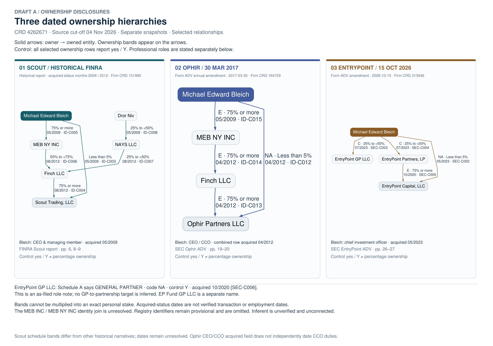
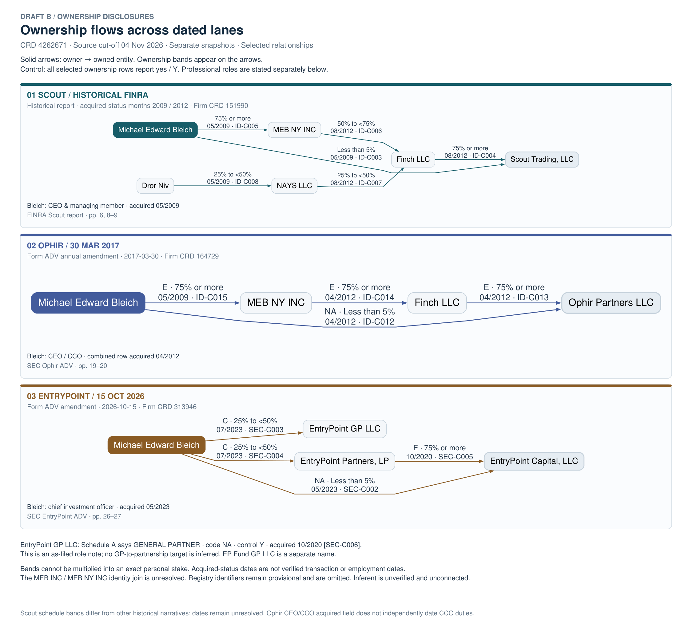
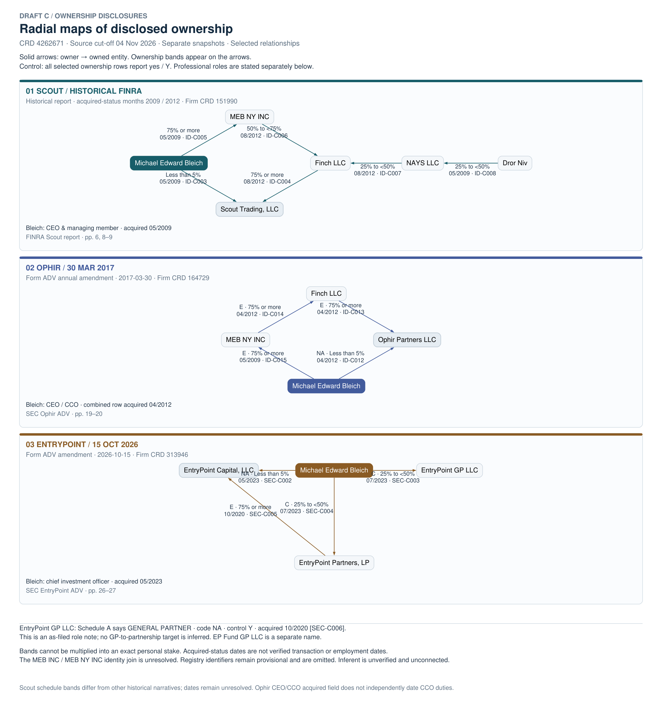
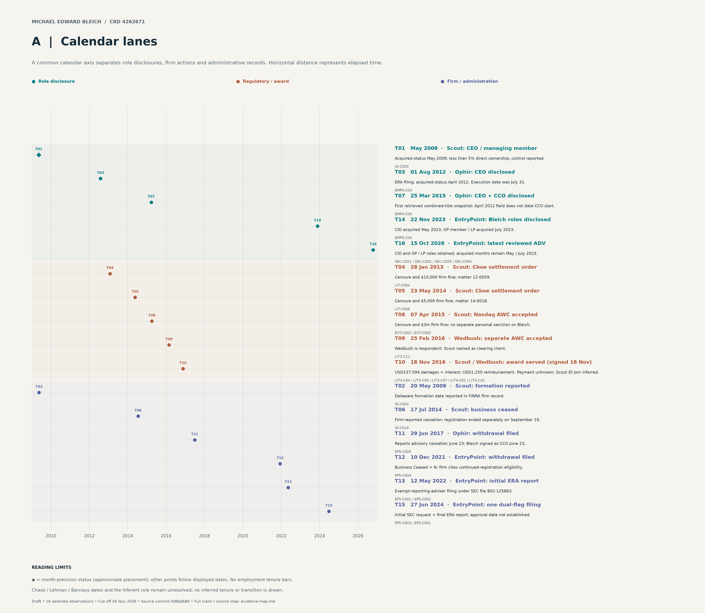
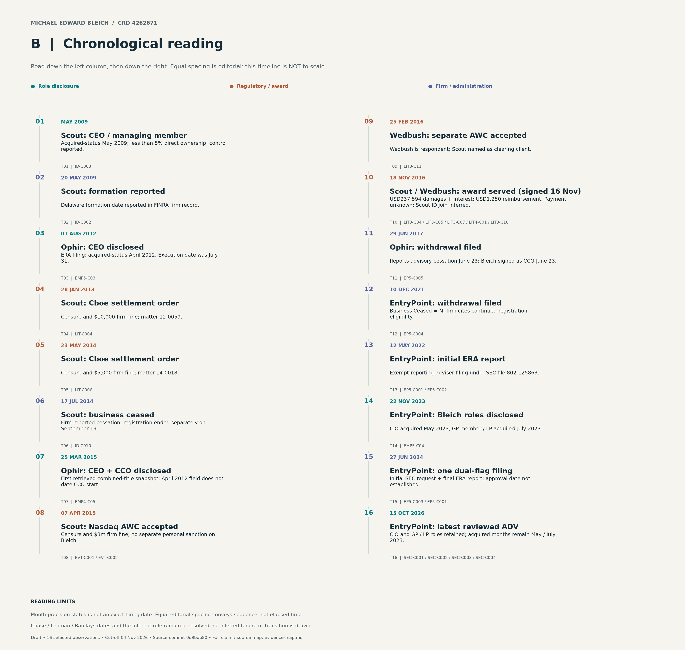
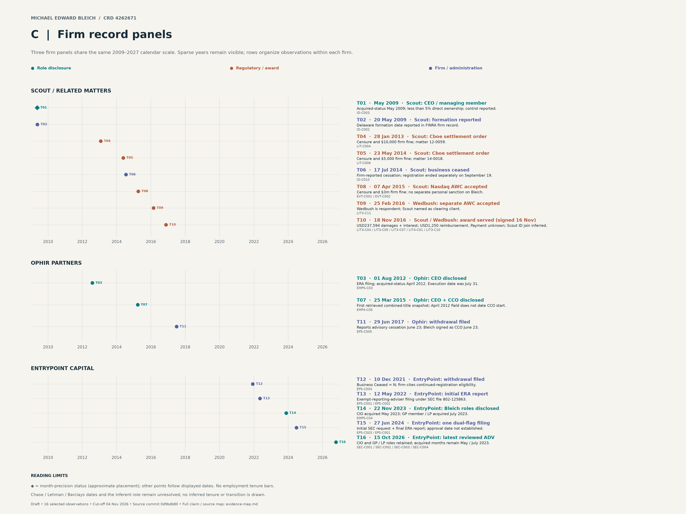

# Six visualization drafts for review

Choose one ownership layout and one timeline layout for refinement. These are **layout alternatives**, not different factual scenarios: all three ownership diagrams contain the same 14 selected relationships, and all three timelines contain the same 16 selected observations.

**Suggested starting pair: Ownership B + Timeline B.** B makes the ownership paths easy to trace; the chronological timeline is easiest to read continuously. Choose Timeline A or C when elapsed time or comparison across firms matters more.

These are large-format drafts: open a PNG at full size or zoom the SVG/PDF to read the source labels. They have not been approved for final inclusion or reduced to an A4/Letter print layout.

## Review index

| Ownership alternatives | Timeline alternatives |
|---|---|
| [A — Dated hierarchies](#ownership-a--dated-hierarchies) | [A — Calendar lanes](#timeline-a--calendar-lanes) |
| [B — Horizontal lanes](#ownership-b--horizontal-lanes) | [B — Chronological reading](#timeline-b--chronological-reading) |
| [C — Radial maps](#ownership-c--radial-maps) | [C — Firm record panels](#timeline-c--firm-record-panels) |

[Visual inventory](INVENTORY.md) · [Ownership captions, alt text and source map](ownership/README.md) · [Timeline captions, alt text and source map](timelines/README.md)

The figures retain claim IDs and qualifications. Ownership panels represent separate historical disclosures; ranges are not calculated into personal downstream stakes. Timeline markers are observations, not continuous employment. Firm sanctions are not personal sanctions. Unverified early employment and Inferent affiliation remain gaps.

## Ownership A — Dated hierarchies

Three top-down panels for comparing the disclosed intermediary chains.

[Full-size PNG](ownership/ownership-a.png) · [Vector SVG](ownership/ownership-a.svg) · [PDF](ownership/ownership-a.pdf)



## Ownership B — Horizontal lanes

Left-to-right tracing of owner-to-entity relationships. Recommended starting point for diligence review.

[Full-size PNG](ownership/ownership-b.png) · [Vector SVG](ownership/ownership-b.svg) · [PDF](ownership/ownership-b.pdf)



## Ownership C — Radial maps

Diamond and triangular arrangements emphasize direct interests alongside intermediary paths.

[Full-size PNG](ownership/ownership-c.png) · [Vector SVG](ownership/ownership-c.svg) · [PDF](ownership/ownership-c.pdf)



## Timeline A — Calendar lanes

A true calendar axis separates role, regulatory/award and administrative observations.

[Full-size PNG](timelines/timeline-a.png) · [Vector SVG](timelines/timeline-a.svg) · [PDF](timelines/timeline-a.pdf)



## Timeline B — Chronological reading

Two-column reading sequence, explicitly not to scale. Recommended starting point for narrative review.

[Full-size PNG](timelines/timeline-b.png) · [Vector SVG](timelines/timeline-b.svg) · [PDF](timelines/timeline-b.pdf)



## Timeline C — Firm record panels

Three firm panels share a calendar scale for comparison.

[Full-size PNG](timelines/timeline-c.png) · [Vector SVG](timelines/timeline-c.svg) · [PDF](timelines/timeline-c.pdf)



## Provenance and handoff

Research cut-off: **November 4, 2026**. Visualization preparation: **November 5, 2026**. Inputs were pinned from reviewed research commit `0d9bdb80d7c4e21a38e798eac58ea71e375ee5fb`; later housekeeping commits do not change that basis. [Source snapshot and input hashes](source-snapshot.json) identify the exact files. Copies in `inputs/` preserve the original bytes; their original relative links are not rewritten. Use the family evidence maps for working source navigation.

[Independent semantic QA](review/final-qa.md) · [Rendered review](review/render-review.md) · [Package validation](review/package-checks.json) · [Asset manifest](assets.json) · [Scoped SHA256 manifest](SHA256SUMS.txt) · [Tasks](TASKS.md)

The semantic review checks faithful representation of the selected dossier facts; it is not fresh research or a completeness finding. No dossier, source register, HTML front or investigation-level checksum manifest is edited. All deliverables and checkpoints are within this visualization folder. The scoped checksum manifest excludes itself and ignored local runtimes/caches.

The separate dossier/HTML team can embed an approved SVG, use PNG as a fallback, and reuse the supplied caption, alt text and evidence map. Editable DOT/JavaScript and Python sources are retained. No integration or deployment is performed here.

## Rebuild

From this folder, with Python and Node available:

```powershell
npm install --prefix .runtime/graphviz --cache .runtime/npm-cache --no-audit --no-fund @viz-js/viz@3.31.0
python -m pip install --target .runtime/python --cache-dir .runtime/pip-cache -r requirements.txt
node ownership/generate.mjs
python ownership/render.py
python timelines/build_timelines.py
python review/check_semantics.py
python work/package_review.py
python work/validate_package.py
```

The pinned Graphviz dependency lock is also retained in `work/graphviz-package-lock.json`. Family READMEs explain source and layout editing. Package validation regenerates the scoped checksum manifest after checks pass.
