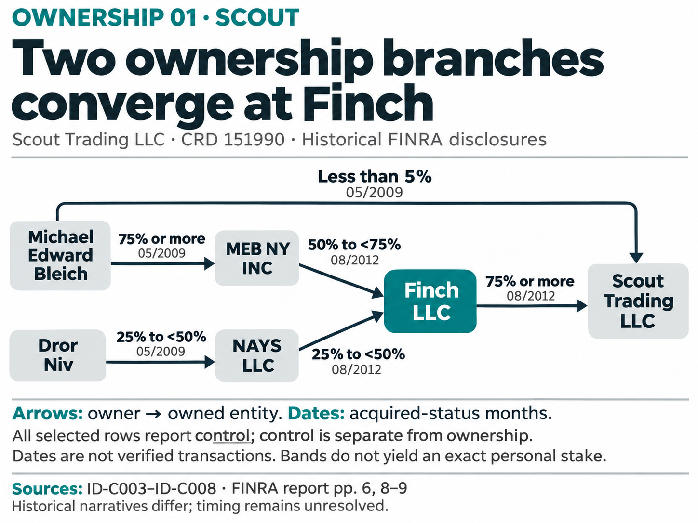
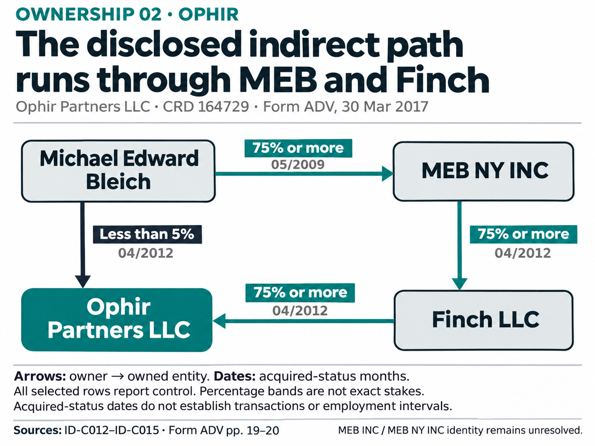
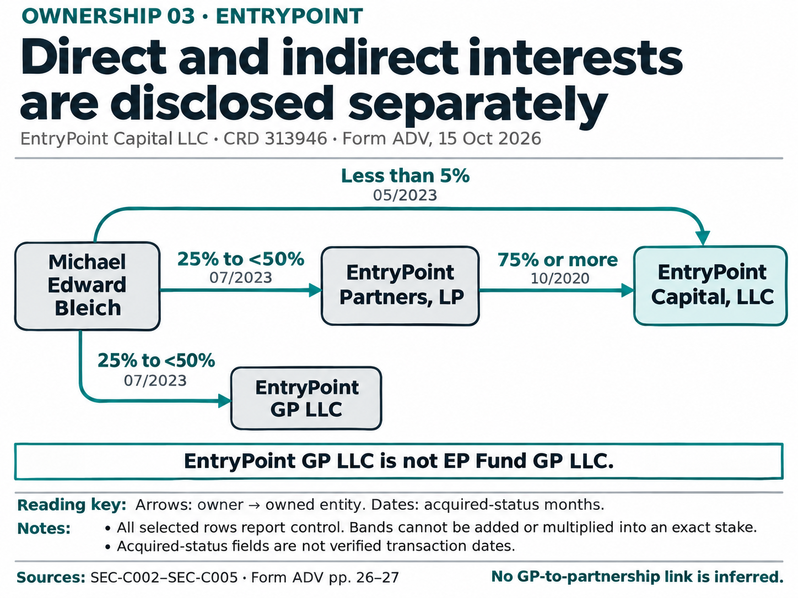
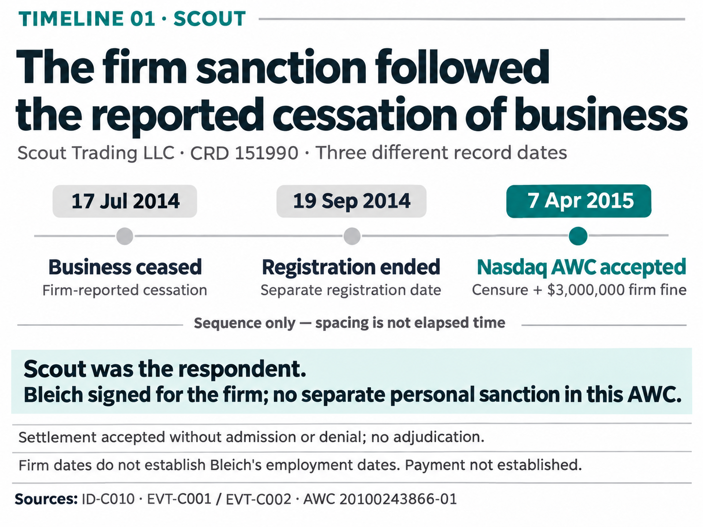
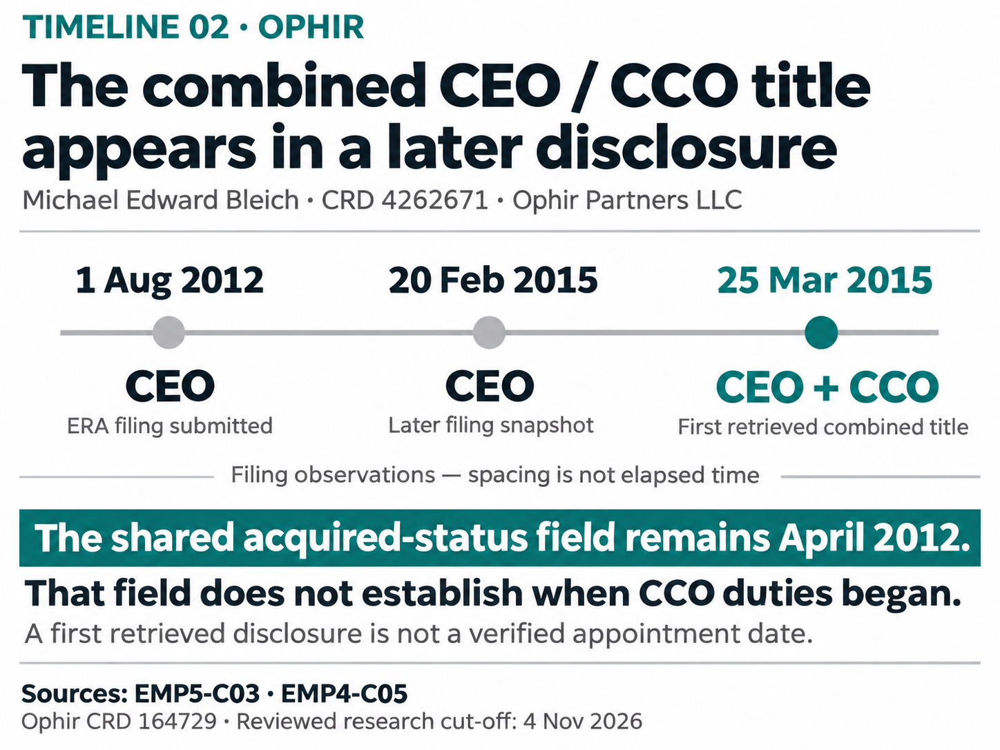
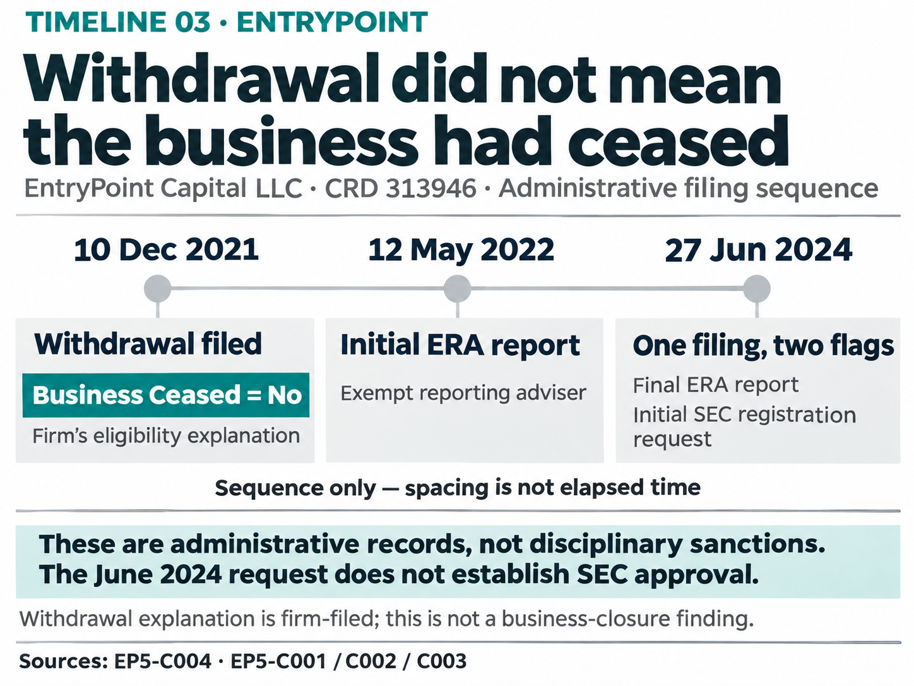

# The earlier charts, reworked in the new style

Six static **design proofs for review before implementation**, using the large headlines, direct labels and restrained navy/teal palette of the three recent storyboard proofs. Each image displays at **800 pixels wide**, or narrower on a small browser window. The [six-page PDF](report-size-proofs.pdf) places one chart at **180 mm wide on each A4 page**; print at actual size.

## What was reworked

The original three ownership drafts were layout alternatives containing the same three historical snapshots. They are now three firm-specific stories, retaining **all 14 selected ownership relationships** across the set. The original three timeline layouts repeated 16 mixed observations; the reworked timelines select **nine milestones from the pinned research** to explain three narrower stories. This is an editorial re-selection, not a claim to reproduce the full chronology.

The [original six drafts](../../README.md) and the [three recent storyboard proofs](../2026-11-05-storyboards/README.md) remain unchanged. New proofs are separate review assets, not a silent replacement of the original evidence or charts.

## Ownership 01 — Scout: two branches converge at Finch

**Review question:** Can you immediately trace the two branches to Finch and distinguish the separate direct Scout interest?

## Ownership 02 — Ophir: the indirect path uses two intermediaries

**Review question:** Are the indirect path and the below-5% direct interest clearly different routes?

## Ownership 03 — EntryPoint: direct and indirect interests are separate

**Review question:** Can you distinguish the Capital ownership paths from the separate GP branch?

## Timeline 01 — Scout: cessation and sanction have different dates

**Review question:** Does the sequence make both the timing and the identity of the sanctioned party clear?

## Timeline 02 — Ophir: the combined title appears later

**Review question:** Is it clear why the shared April 2012 field cannot date the start of CCO duties?

## Timeline 03 — EntryPoint: withdrawal does not mean closure

**Review question:** Can you distinguish withdrawal, initial reporting and a registration request without reading them as closure or approval?

## Evidence, method and review

[Selected facts and full supporting claim records](selected-data.json) · [Evidence map](evidence-map.md) · [Review checkpoint](review-checkpoint.md) · [Asset manifest](proof-manifest.json) · [SHA256 hashes](SHA256SUMS.txt)

Built-in image generation produced these raster design mockups. Exact prompts are retained in [prompts/](prompts/). No chart renderer, dossier or HTML-front implementation was changed. The page uses images and captions solely to present the review assets. Production will require editable vector/text output, accessibility support and normal-size checks after design selection.

Independent review passed all 14 ownership edges and nine timeline milestones, including party, band, month, date meaning and visible limitations. This is an internal review, not user approval. The smallest footers are the densest text; subtle gradients are a remaining optional polish choice. The timelines explicitly use editorial spacing, not calendar distances.

Research cut-off: November 4, 2026. Pinned source commit: `0d9bdb80d7c4e21a38e798eac58ea71e375ee5fb`. Prepared November 5, 2026. All task writes are in this new visualization proof folder on the existing migration branch.
