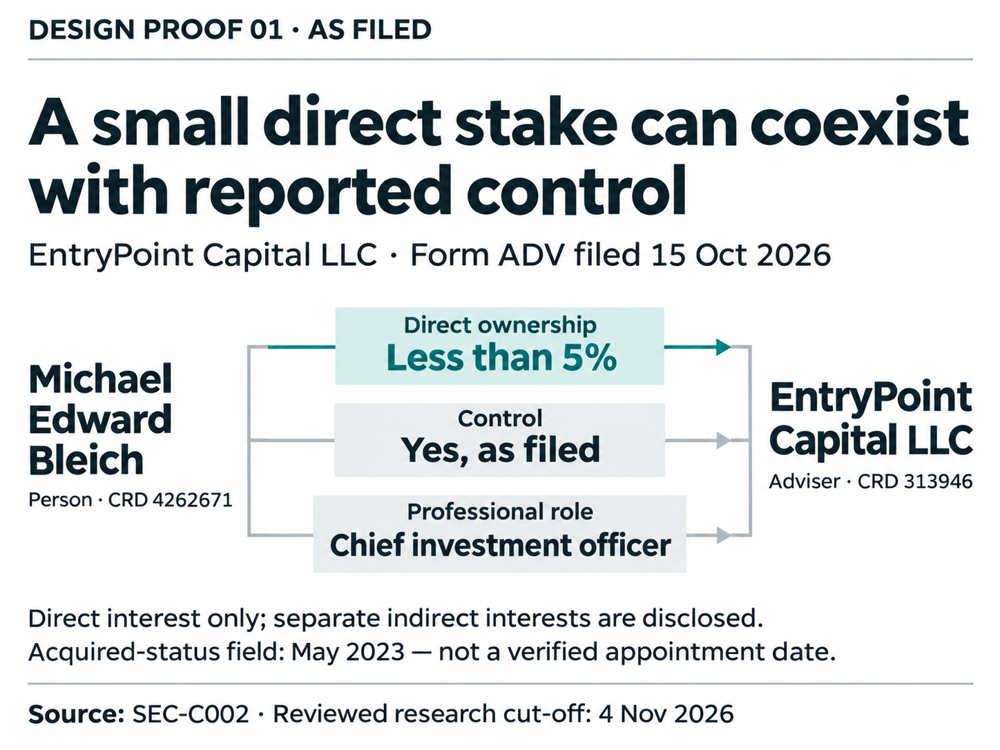
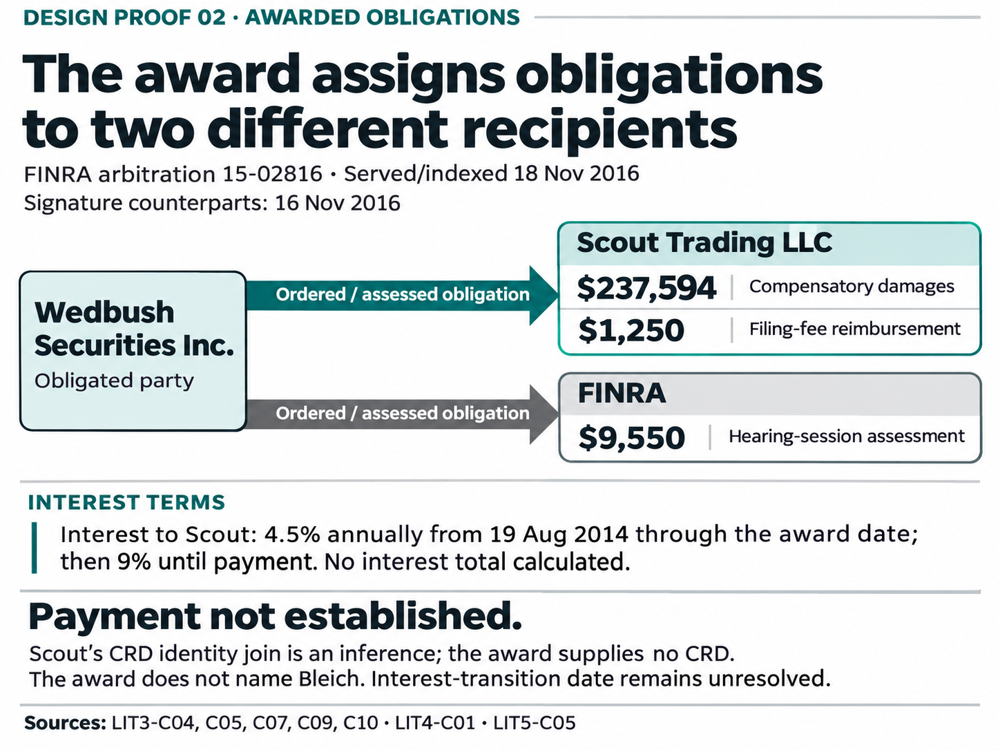
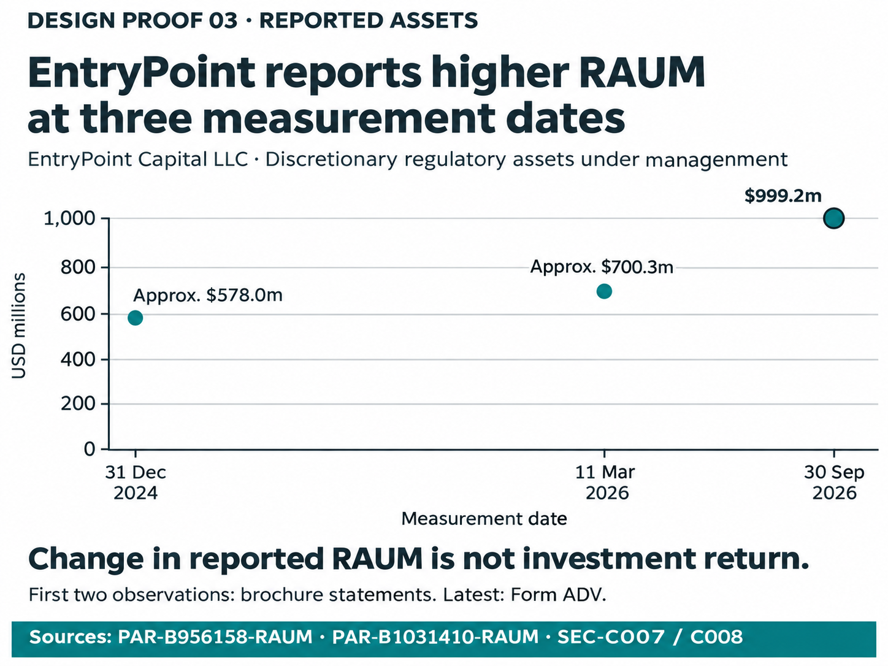

# Three visual design proofs

**For composition review before coding.** Each proof answers one question. The previews below display at **800 pixels wide** (or narrower if your browser column is smaller). The [three-page print proof](report-size-proofs.pdf) places each chart at **180 mm wide on an A4 page**; print at actual size.

These are static raster mockups made with the built-in image-generation tool. They are design references, not implemented charts. Text and material relationships were checked against the approved storyboards. Quantitative geometry is illustrative at proof stage; exact data-coordinate rendering and accessible vector/text equivalents belong to implementation after review.

## 01 — Ownership, control and role

**Question:** Does a below-5% direct stake describe the whole disclosed person–firm relationship?

**Review:** Can you distinguish the ownership percentage from the control field and the professional role without reading the source notes?

## 02 — Award recipients

**Question:** Under the award, who was obligated to pay whom?

**Review:** Are the two recipients immediately clear, and does the graphic make it clear that an obligation is not proof of payment?

## 03 — Comparable RAUM observations

**Question:** What do the reported discretionary-RAUM observations show across their measurement dates?

**Review:** Can you read the dates and amounts at normal size, and distinguish increased reported assets from investment performance?

## Review status and next step

Independent visual/evidence review passed these as **design proofs**. Main labels and qualifications were assessed at approximately report-column width. No user approval or completed usability study is claimed. Source footers are the densest material; their full meanings and source claims are available in the [evidence and text equivalents](evidence-notes.md).

An optional next refinement for proof 02 is to label the upper arrow “Ordered to pay” and the lower arrow “Fees assessed payable to.” The current shared label is accurate; this is a clarity choice for review.

Please review story clarity, reading order, emphasis and normal-size legibility. After the designs are selected, chart implementation can produce exact geometry, editable vector output and accessible text/data counterparts. Existing charts, source dossier and HTML front were not edited by this task.

[Approved storyboards](../../design/2026-11-05-story-first/storyboards.md) · [Review checkpoint](review-checkpoint.md) · [Generation and export metadata](proof-manifest.json) · [Scoped hashes](SHA256SUMS.txt)

Prompts are retained in [proof 01](prompts/proof-01.txt), [proof 02](prompts/proof-02.txt), and [proof 03](prompts/proof-03.txt). Research basis: Nov 4, 2026 snapshot, commit `0d9bdb80d7c4e21a38e798eac58ea71e375ee5fb`. Design basis: `81840b3c9fd4cd8189733d15a7088361e5246a18`. This package stays within visualization/ on the existing migration branch.
